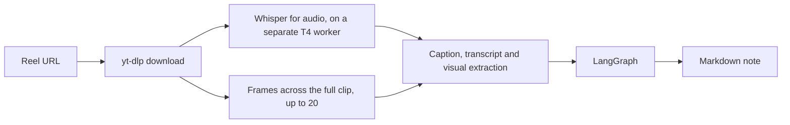
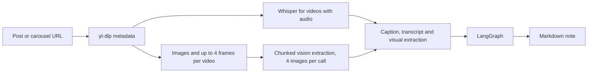
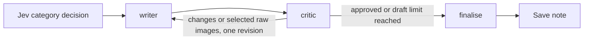
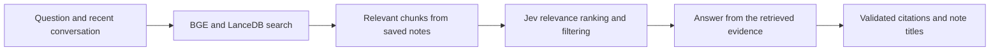
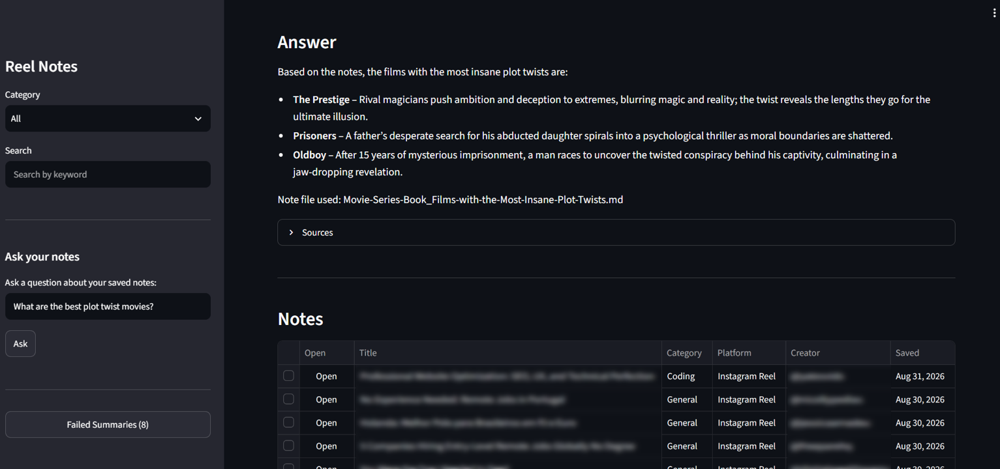
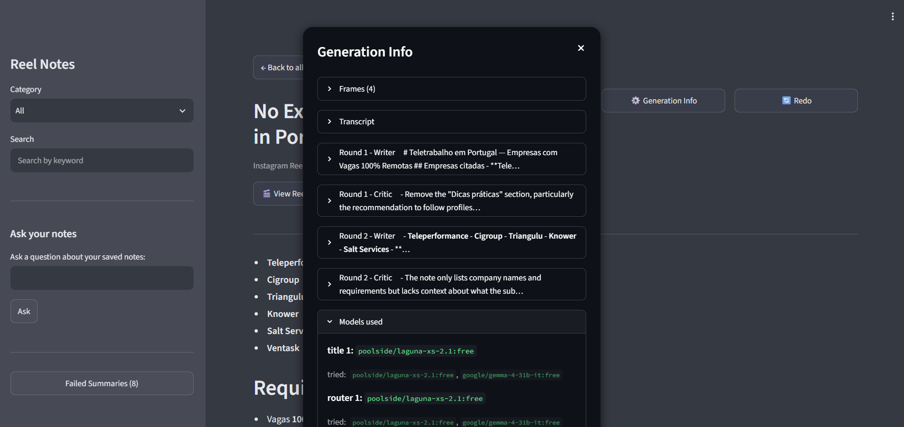

# AI Personal Assistant

A Telegram bot that turns Instagram Reels, posts, and carousels into structured notes. Send it a link and a few minutes later a clean markdown note lands in the notes dashboard. It also remembers things I tell it, answers questions and sends reminders through Telegram.

I used to save a lot of reels and never look at them again. So I built this personal assistant that saves all as notes for me. Each reel becomes a short note I can search later, instead of another line in my likes or saved posts. It is a personal tool, not a product, and it runs for my own accounts on my Modal workspace. You can easily deploy the same setup for yourself.

## How it works

Reels:



Posts and carousels:



For a reel, the video is downloaded, its audio is transcribed with Whisper, and frames are pulled from across the full clip. Silent videos skip transcription. The CPU worker handles downloads, frames and model calls; a separate T4 container loads Whisper turbo once and only handles transcription.

Posts and carousels use the same text-first approach. Images come from thumbnails, each carousel video contributes up to 4 frames, and videos with audio are transcribed too. One vision pass extracts visible text and subjects. Successful extraction is cached, so retry and redo can reuse it instead of paying to extract the same media again.

The caption, timestamped transcript and visual extraction stay separate. The writer starts with that text, and the critic asks for selected raw images only when something is unreadable or missing. Incomplete extraction is recorded rather than quietly left out.

Then the LangGraph takes over.

## The agent graph

The graph is small on purpose: Jev picks a category, one writer drafts the note and its title, and a critic reviews it.



The writer uses instructions for culinary, travel, entertainment, coding, finance, career or general notes. LangChain provides the writing and review clients, with one primary model and one paid fallback per task. Calls have deadlines and only temporary failures are retried, so a dead provider does not keep the pipeline waiting indefinitely.

There are at most two drafts. The writer and critic receive the same text evidence, and a detail that is only visible on screen still counts. If review fails or the second draft still needs work, the note is kept with an unverified or needs-review status rather than presented as approved.

## Observability

Generation Info keeps the caption, transcript, visual extraction, writer/critic rounds and model choices with each note. Useful errors stay in the dashboard's owner-only details, while Telegram gets a short explanation of what happened.

LangSmith tracing is still optional through `LANGCHAIN_TRACING_V2`, `LANGCHAIN_PROJECT` and `LANGSMITH_API_KEY` in the Modal secret. Leave those variables empty and it stays off. The app does not need tracing to save notes, show Generation Info or record costs.

## Asking your notes

When a note is saved, its body is embedded by a local BGE model and placed in a LanceDB vector store on the same data volume, so all your data stays in one place. Generation Info and internal cost/error sections are left out of the index, which keeps retrieval focused on the note itself.



Ask a question in Telegram, use `/ask`, or open the dashboard's Chatbot page. The app searches notes by cosine similarity, then Jev scores the matches and filters out the weak ones. Search still works if Jev is unavailable. There is no fixed limit on the number of notes, though each answer has a context budget. An ordinary question replying to a source uses that note directly. Comparisons also search and rank related saved notes, using the focal note's actual evidence as the search context.

The dashboard answers from saved notes and relevant personal memory. Its Sources dropdown shows the note titles, and chat history lasts for the current browser session. If it cannot find anything relevant, it says so. Telegram can also use the model's general knowledge, with citations for saved evidence and brief attribution for personal memory or model knowledge. That last part may need checking because the bot cannot research the web. Ask it to use only saved evidence if you want to leave general knowledge out. Chat history helps it understand follow-ups, but does not count as evidence or personal memory.

The starting thresholds are 0.45 maximum cosine distance and 0.65 Jev relevance. They have not been calibrated on my notes yet. `RAG_JEV_ENABLED=false` disables the extra Jev request. The dashboard has a **Reindex notes** button in Settings; rebuilding uses a new table and keeps the working index if the rebuild fails.

## Models

Each task keeps its own model list in `core/config.py`. Most writing and review primaries are free tier on OpenRouter, with a paid fallback when the primary is unavailable. The lists are plain and easy to swap when a provider retires one.

Jev (`typesafe/jev-1.13`) picks categories, ranks search results and helps route unclear Telegram messages through OpenRouter's System One API. Writing and answering use the other model chains. If category routing fails, the note goes into general without another writing-model call. The category confidence threshold starts at 0.70; I have not calibrated it yet either.

If processing fails, the attempt is kept in Error/Failed for retry. Provider details stay private; Telegram never gets a stack trace or a list of raw provider errors.

## Costs

Each note version keeps its own extraction, routing, writing and review charges, including retries. The header shows a summary, and **Cost details** at the end shows the individual calls and measured compute usage. That section stays visible even if the app recorded no charges. Missing records show **Cost not recorded**; missing provider charges show **AI cost unavailable**. If the note's cost records are missing, the app checks the job record for that same version. Reusing cached extraction adds no API charge, and older versions keep their original costs.

OpenRouter's returned `usage.cost` is used when available. Missing charges are marked unknown, and legacy notes show **Cost not recorded**. Optional Modal resource rates add compute estimates, but GPU cold starts and shared idle time are not fully allocated. The displayed amount is recorded or estimated cost, not a promise of exact billing or savings.

## Stack

- Python 3.11+
- Modal for deployment, with an isolated T4 worker for audio transcription
- LangGraph and LangChain for the agent flow
- LanceDB for vector search
- fastembed for local embeddings
- OpenRouter for writing, review and Jev decisions
- OpenAI Whisper for transcription
- yt-dlp and ffmpeg for download and frames
- Pillow for image resizing
- Streamlit for the dashboard
- Telegram Bot API

## Layout

```text
modal_agent/
  app.py
  dashboard.py
  dashboard_server.py  dashboard server and remembered-device cookies
  core/
    config.py       model lists per task
    state.py        graph state
    graph.py        the agent graph
    llm.py          model clients, retry and fallback handling
    decisions.py    Jev categories and relevance scores
    conversation.py local-first Telegram intent routing and clarification
    workflow.py     the processing pipeline
    media.py        downloads, transcription requests and frames
    processor.py    carousel media classification
    storage.py      shared notes, jobs, caches and index operations
    rag.py          semantic search and answers over saved notes
    accounting.py   per-version costs and compute estimates
    requests.py     Telegram input and Instagram URL validation
    telegram.py     messages and reactions
    auth.py         remembered-device credentials
    errors.py       short messages and private error redaction
```

Markdown notes and LanceDB stay on the Modal data volume. One storage function serialises shared changes, while expensive processing happens outside it. Stable source IDs catch duplicate links before any AI call, and job claims prevent an old worker from replacing a newer attempt.

## Setup on Modal

You need a Modal account and the CLI.

1. Create or edit `personal-assistant-secrets` in the Modal dashboard. Add:

| Setting | Value |
|---|---|
| `TELEGRAM_BOT_TOKEN` | Your bot token from BotFather |
| `OPENROUTER_API_KEY` | Your OpenRouter API key |
| `TELEGRAM_ALLOWED_USER_ID` | Your numeric Telegram account ID |
| `TELEGRAM_WEBHOOK_SECRET` | A random secret you generate and also register with Telegram |
| `DASHBOARD_PASSWORD` | A password you choose for your private dashboard |
| `UI_URL` | The deployed dashboard URL |

For a first deployment, use a temporary `UI_URL` such as `https://example.com`, then replace it with the printed `ui` URL and redeploy. Missing required keys block deployment; incoming messages are rejected if webhook security settings are empty.

Optional settings for budgets, media limits, thresholds and compute rates are in [`modal_agent/.env.example`](modal_agent/.env.example). A local `.env` file alone does not populate the named Modal secret. Optionally add `LANGCHAIN_TRACING_V2`, `LANGCHAIN_PROJECT`, and `LANGSMITH_API_KEY` for LangSmith tracing.

2. Deploy:

```text
cd modal_agent
modal deploy app.py
```

The data volume is created automatically on the first run. Whisper weights use a separate cached volume.

3. Point Telegram at the printed `telegram_webhook` URL, passing the same webhook secret:

```bash
curl --request POST \
  --data-urlencode "url=$TELEGRAM_WEBHOOK_URL" \
  --data-urlencode "secret_token=$TELEGRAM_WEBHOOK_SECRET" \
  --data "drop_pending_updates=false" \
  --data 'allowed_updates=["message","callback_query","message_reaction"]' \
  "https://api.telegram.org/bot${TELEGRAM_BOT_TOKEN}/setWebhook"
```

This example uses Bash environment variables; keep the token and secret private. Adding the secret in Modal is not enough: Telegram must send it with each request too. Use the webhook URL, not the dashboard URL.

Send a reel, post, or carousel link to the bot. It reacts to your message while it works, then replies with the saved note title and link. Sending the same source again tells you whether it is already saved, still running or waiting for retry, without another AI call.

## Usage

F02, F03 and reminders are implemented locally. They still need deployment and about a week of testing on Modal before I call them validated. Full F04 list management is for later.

You can talk to the bot normally. Slash commands are there if you need them.

| Say | What happens |
|---|---|
| `What is compound interest?` | Uses relevant notes and memory, with any general knowledge labelled separately. |
| `Recommend a film`, then `Another one` | Keeps the conversation's context and checks remembered watched films. |
| `Make this note shorter` (replying to its link) | Revises the note using cached evidence. |
| `I watched Arrival.` or `Remember that I avoid dairy.` | Saves what you said, along with the message and date. |
| `Actually I now live in Porto.` | Corrects the residence fact if there is one clear match; otherwise asks which fact you mean. |
| `Show my memory`, `Forget Arrival` | Shows memory or removes a matching fact. If several match, it asks. |
| `Show my notes`, `Open the dashboard` | Lists notes or gives you the dashboard link. |

Clear questions, links, personal facts and common revisions use local rules. Other requests use the configured primary basic model to propose a structured action, with bounded source, task and conversation context. The app validates that proposal before changing data. It does not use the paid fallback for interpretation. A low-confidence, invalid or failed interpretation asks a specific question instead of storing an unresolved phrase. You can describe what you want in ordinary English or Portuguese; you do not have to choose an internal action category.

Set `TELEGRAM_ROUTER_ENABLED=false` to turn off model interpretation. `TELEGRAM_ROUTER_CONFIDENCE` accepts 0.80 to 1.00 and defaults to 0.90. `TELEGRAM_ROUTER_TIMEOUT_SECONDS` defaults to 8, with a maximum of 10, including any temporary-failure retry. Answers still use the existing answer model chain and its paid fallback. Asking about a source does not revise its note.

Recent Telegram conversation stays on the existing Volume, separated by chat and topic. The bot keeps up to 12 messages and 12,000 characters from the last 24 hours, across at most 200 conversations. Older chat context drops out, so repeat temporary constraints when changing topics or returning later. Personal facts and preferences have their own persistent storage. A delayed interpretation cannot overwrite a correction or restore forgotten memory, and an older answer is held back if a newer turn has replaced it. Web research, external actions and full F04 collections are still for later.

### Reminders and the morning brief

Say `I need to try this`, `I want to use this soon`, or `I need to pay rent` to schedule a reminder. If you leave out the date and time, it goes into the next day's 09:00 brief in Europe/Lisbon. That means tomorrow even if you send it before 09:00 today. The brief groups due reminders that have no explicit clock time. If nothing is due, the bot says nothing.

Facts such as `I watched Arrival`, preferences such as `I prefer concise notes`, and uncertain statements such as `I might try this` do not create reminders. Neither do negated intentions.

- `Remind me to call the dentist` goes into tomorrow's 09:00 brief.
- `Remind me tomorrow at 6pm to call the dentist` sets an individual timed reminder.
- `Remind me to stretch in 10 minutes` uses a relative time.
- `Remind me to renew my passport on 2026-11-03` goes into that date's 09:00 brief.
- `Show my reminders` or `What do I need to do?` shows open tasks and their times.
- `I called the dentist`, `I've already paid the electricity bill`, or `Done with the passport renewal` completes the matching task.
- `Cancel the passport reminder` cancels it by description.
- `Could you move the dentist reminder to tomorrow at 6pm?` changes its time.

You can also say `Move that to tomorrow`, `I tried it`, or `I'm done`, or reply to a delivered reminder. If several tasks fit, the bot lists their names and dates. Answer with something like `the passport one`, `tomorrow's one`, or `the second one`. If you ask to move a task without saying when, it asks for a time; `tomorrow at 6pm` is enough to answer.

Reminder messages use task names. Replies to a delivered brief retain that message's numbered tasks, so replying to an older brief still changes the right item. The latest 1,000 task-message mappings are kept. Without a reply, recent task focus and clarification last 10 minutes within the same chat/topic. If several tasks fit, the bot asks which one. An old interpretation cannot overwrite changed work. Existing slash commands still work.

Scheduling, listing and delivering reminders use no AI calls. Common task changes are also matched locally; other wording can use the bounded interpreter. Supported times include today/tomorrow, `on YYYY-MM-DD`, `on Friday` or `next Friday`, `at HH:MM`, `at 9am`/`at 6pm`, and relative minutes, hours or days. Portuguese calendar words such as `amanhã` and `sexta-feira` are supported too. A date without a clock time uses the existing 09:00 brief in Europe/Lisbon. Dates are resolved from the original Telegram message, even if processing is delayed. Ambiguous or skipped clock-change times ask for clarification. Custom repeating schedules are not supported.

For a task linked to a reel, the reminder keeps the source link while the note processes. The brief uses the saved note's current title when available, and the link otherwise. The app saves personal memory and its automatic reminder together, and only confirms scheduling after storage succeeds. Forgetting or correcting an intention cancels its old reminder. Older intentions do not automatically become reminders; say `Remind me to…` to schedule one.

Tasks live in the existing Volume registry, separately from personal facts, source recall and delivery history. Unfinished tasks appear in each morning brief from their eligible date until completed, cancelled or snoozed. An explicitly timed task gets its first reminder at that time, then joins later morning briefs if still open. A request to repeat a source tomorrow is an informational notification and is sent once. Compound installation/testing requests keep separate actions, so installing something does not complete its testing. Up to 200 open tasks of 1,000 characters each are supported; the latest 200 closed records are retained.

A private [Modal scheduled function](https://modal.com/docs/guide/cron) checks for due reminders every minute after deployment. It uses CPU only and needs no new credentials or webhook changes. The app stores the due time exactly, but startup, queued work or an outage can delay delivery. The next successful check picks up overdue reminders. Long briefs split into messages, with up to four messages per check. Empty checks send nothing and make no AI calls. They read the registry without waking storage, though the minute timer still uses Modal compute.

Clear temporary Telegram rejections retry up to three times per day, five minutes apart. A timeout or interrupted send is uncertain and is not automatically repeated that day. An unfinished task can appear in the next day's brief; a one-off notification stays uncertain until explicitly retried. Delivery attempts, successful sends and task completion are separate. Telegram cannot guarantee exactly-once delivery. `Show my reminders` includes failed or unconfirmed delivery; `retry reminder about the dentist` allows another attempt. Live timing still needs testing on Modal.

### Instructions for a note

Put instructions beside a link or in a media caption, including a hidden Telegram link:
`https://instagram.com/p/.../ Use Portuguese, full code, then a short checklist.`

The app keeps your exact wording, message ID and date separately from the source evidence. Writer and critic receive the instructions oldest first. Later instructions override earlier conflicts, while compatible requests still apply. Generation Info shows this history. You can ask for research depth, but external research is unavailable; the note says it was not performed.

Reply to the original link or its saved-note message with more instructions, or use `/revise <instructions>`. `/revise <link> <instructions>` also works. A direct follow-up normally uses the latest user-shared source in that chat/topic, including while processing is running. Several older links do not make that latest link ambiguous. Completion order never changes source focus. Explicit replies and clear named references take precedence. Ordinary focus lasts up to 24 hours and clears on a topic change; the old `FOLLOWUP_SECONDS` setting is no longer used. The latest 500 source-message associations per conversation are kept. For older associations, resend the link or name the source.

Instructions have a limit of 4,000 characters per message and 12,000 per source. The app tells you if you exceed it. Repeating the same instructions consecutively, or sending the same bare link, does not regenerate the note.

New instructions replace an attempt that is still running. The old worker cannot save a note or overwrite cached evidence. A call already in progress has to finish, but the worker checks its job claim before making another model call. Charges already incurred stay with that attempt in Error/Failed. The replacement reuses validated cached media and extraction. Missing, changed, incomplete or incompatible evidence may need extracting again. Your current note stays available until the replacement succeeds, with the usual retry and previous-version behaviour if something fails.

### Bringing a source up later

After sharing a post, say `Remember these when I ask for niches` or `Bring this up when I look for channel ideas`. The app saves the source and topic, even before the note is ready. Later questions in Telegram or the dashboard can retrieve its current note, with citations. This creates neither a personal fact nor a scheduled reminder. Topic matching uses local words and embeddings, with up to five matches. `/memory` shows these associations; `/forgetrecall <topic>` removes one without deleting the note.

### Personal memory

Personal memory is separate from saved-source evidence and temporary chat history. Tell the bot something about yourself, and you can ask about it later.

- `I watched Arrival.`, `I live in Lisbon.`, and `I prefer concise notes.` use local rules for whole first-person statements, without a model interpretation call.
- After a link, `I need to try this` or `I want to use this soon` saves an intention tied to that source. It keeps your original wording, message and date while the note processes, then uses the note's current title in memory and answers. The app does not turn the source's claims into personal facts or assume you completed the task. Clear affirmative intentions also schedule reminders as described above. `I already use this tool` and `I like this reel` keep their source link too. If the reference is unclear or too old, reply to the intended link. `/remember I need to try this` works as well.
- `/memory` shows IDs, wording, scope and date. `/remember I watched Arrival.` saves a fact explicitly. For other wording or languages, use `/remember <scope>: <exact statement>`, such as `/remember coding: I prefer complete runnable examples.` Scopes are `general`, `notes`, `films`, `coding`, `travel`, `culinary`, `finance`, `career`, and `entertainment`.
- `/correct <ID> <replacement statement>` replaces the fact with that ID. `/correct <ID> general: <exact wording>` also accepts uncertain or dated corrections. Conflicting natural statements ask for an ID. Residence has one slot, films have one per title, and note style has one natural preference slot. Independent general preferences can coexist, and explicit scoped entries allow more than one independent preference.
- `/forget <ID>` removes the active memory entry. It leaves generated notes, archived versions, cached evidence, displayed chat history, Telegram messages, external backups and retained Volume snapshots alone.

Watched films help with relevant answers and recommendations; they are not a full watchlist. The app keeps negation and uncertainty in the wording you gave it. Posts, forwarded or quoted messages, transcripts and assistant answers never become personal memory. A request such as "Focus on the code in this post" stays with that source.

Local memory recognition is deliberately narrow. The interpreter can recognize other clear first-person statements, keeping their original text. It does not silently save one-off instructions or claims attributed to someone else as facts about you. Unclear subjects make it ask. You can ask questions and request revisions naturally, with `/ask`, `/revise` and the memory commands as fallbacks.

Memory stays in the existing private Volume registry, with stable IDs, source messages and dates. Updates run one at a time. You can keep up to 200 active entries of 1,000 characters each. Retrieval uses local word and scope matching, plus titles from retrieved notes. Movie recommendations also include watched-film facts. Questions about you bring in broader personal context, so you do not have to repeat a fact word for word. A relevant linked intention also retrieves its current note, even if normal note search misses it. This needs no new service or model.

If relevant memory exceeds 8,000 characters, the app asks you to narrow the question or review `/memory`. It does not silently drop constraints to fit. Both Telegram `/ask` and dashboard answers use current relevant memory, labelled separately from note findings, and can answer from memory alone. Try `What tool did I want to try, and what does it do?` in either interface. Your intention and the note's explanation remain separate cited evidence.

The app resolves source references when reading memory. Finishing a note does not rewrite memory or bring back a forgotten intention. It does not guess links for older unlinked entries either. To attach one, reply to the original link with `correct <ID> I need to try this`.

Scoped preferences act as defaults; your current instructions override them. If memory changes while an answer is being written, the app asks you to try again. If relevant memory changes during note generation, that attempt cannot save and stays available for retry. Reminder delivery alone does not invalidate an answer or note. Earlier chat messages remain historical. Answers use the configured answer model chain and its existing costs; casual memory interpretation has no paid fallback.

### Telegram and dashboard

Send one public reel, post or carousel URL at a time. Other useful commands are:

- `/notes` lists saved notes.
- `/find <keyword>` searches their content.
- `/ask <question>` uses the same conversational answer path.
- `/link` gives you the dashboard URL.

Telegram answers render bold and code, and hide sources until you request them. Tap **Sources** for readable note titles, clean Instagram URLs and dashboard links. This makes no extra AI call. Emoji reactions can also request sources where Telegram delivers them: the bot must be a chat administrator and the webhook must subscribe to `message_reaction`. In private chat, use the button. Source mappings last for up to 30 days or the latest 1,000 answer messages, and exclude deleted notes. If needed, re-register the webhook with the `allowed_updates` above. Deploying the code does not change Telegram subscriptions.

The dashboard has Notes and Chatbot pages. The sidebar has collection/category filters and Settings; use Chatbot to search and ask questions. Open a note through its title, or select rows and press Delete. Deletion asks for confirmation. Each note has source/account links, Generation Info and Cost details. **Show selected media** opens a small gallery that wraps to fit the screen. Use an image's expand icon to see it larger. Settings has refresh, reindex and sign out. Dark is the default theme; Streamlit's theme menu also has light mode.

Sign in on each device and choose **Remember this device for 30 days**. The browser stores a signed cookie. Signing out clears it, and changing the password invalidates remembered devices. Dashboard chat history lasts for the current session rather than carrying over to new sessions.

Failed notes have Retry; finished notes have Redo. Redo keeps the current note available while it processes a replacement. If it fails, the note stays in Notes. If it succeeds, the old version moves to Error/Failed as **Previous version — replaced by redo**, with its original media and costs. A saved note that failed indexing also stays available, marked as not searchable yet.

Drafts marked **Needs review** stay in Notes, including ones with partial visual extraction. Notes sort newest first. **Back to collection** returns to the note's section and clears category filters so you can find it.

If a provider could not extract some frames, use **Retry missing media**. It reuses validated cached media, transcription and successful extraction chunks, then retries the missing chunks before writing the note with its existing instructions. It can still fail if the providers remain unavailable. The current note stays available and charged attempts stay recorded. The reviewer receives failed-extraction frame IDs so it can request the right raw images. Incomplete evidence cannot be marked approved. Missing evidence alone does not trigger another writer round if the critic asks for no content changes. There are no new automatic extraction retries or model providers. For a concise buy/sell summary, the writer reports the source's stated actions and conditions, and says when timing was not specified.

## Testing

Offline tests use temporary storage and fake external services, including Streamlit AppTest. They cover permissions, duplicates, retries, redo, evidence, costs, retrieval, citations and dashboard actions without paid calls or live data.

```text
python -m pytest tests -q
python -m compileall -q modal_agent tests
```

The workflow comparison in `tests/test_payloads.py` checks request and image payloads against the earlier pipeline. Mocked payload reductions do not prove live answer quality or billed savings. After deployment, check one reel, one carousel, a duplicate link, `/ask`, successful/failed redo, costs and login on both desktop and phone. Remote GPU/Volume behaviour and browser layouts still need that manual check.

## Roadmap

- **F02: Instructions and follow-ups.** Implemented locally; still needs deployment and about a week of testing on Modal.
- **F03: Personal memory and scoped preferences.** Implemented locally, including watched-film facts; needs the same testing.
- **Reminders and morning brief.** Implemented locally; still needs testing on Modal.
- **F04: Full list management.** For later, including collection workflows and external actions.

- **Phase 1 (Completed):** Extract audio from reels, run Whisper transcription, and generate structured notes with an LLM.
- **Phase 2 (Completed):** Add a LangGraph critic-refiner agent loop to evaluate draft notes and enforce structure.
- **Phase 3 (Completed):** Extract frames across the full clip and keep readable visual evidence for the note.
- **Phase 4 (Completed):** Ask your notes questions in plain language. Notes are embedded locally and searched semantically, and answers come only from the retrieved notes, with the sources named.
- **Phase 5 (Completed):** Support Instagram posts and carousels, including carousel videos, with a text-first pipeline and a raw-media fallback.
- **Phase 6 (Future):** Add human-in-the-loop Telegram prompts for fallback routing when rate-limited (retry with paid model or add the post to a queue), and expand support to other platforms, like YouTube and TikTok. 


## Screenshots

These show an earlier dashboard layout; the current version uses linked titles, a separate Chatbot page and detail expanders.



Notes table with categories, creators, and saved dates, plus the Reindex notes button. The current dashboard opens notes through their titles.



Generation Info for one note: frames, transcript, writer/critic rounds, and models used.

### Comparing sources and repairing older entries

After a link, ask `Compare these tools with the other ones I have saved`. The bot compares related saved evidence, states its recommendation criteria and leaves unsupported details unknown. If processing is pending, it saves the question and resumes when the note is ready. Incomplete review stays disclosed. Waiting is limited to 24 hours and 100 open questions, with four dispatches per minute and one generation attempt per question. Questions remain for 14 days. Failed-source notices retry confirmed temporary rejections at most three times, five minutes apart; uncertain sends are not repeated automatically.

From `modal_agent`, run `modal run app.py::repair_personal_data` to preview repairs to older unresolved entries. Review the preview before adding `--apply`. Repairs use retained provenance; unclear targets stay marked for clarification. Existing notes and caches need no reset. Deleted records and unrecorded delivery outcomes cannot be recovered.

These repairs await Modal validation. For failures, search logs for `conversation_event` or `answer_failure` and follow `correlation=`. Logs record stages and delivery outcomes without prompts or credentials. After deployment, compare storage calls and allocated CPU/memory time over 24?48 hours; idle storage calls should fall to zero while due reminders and pending questions still run.
